<!-- The deck is exported from Google Slides as images. The heading below gives the site index its title and is moved off-screen. A PDF with working links is in google-slides-export.pdf. -->

# Introduction to World Models

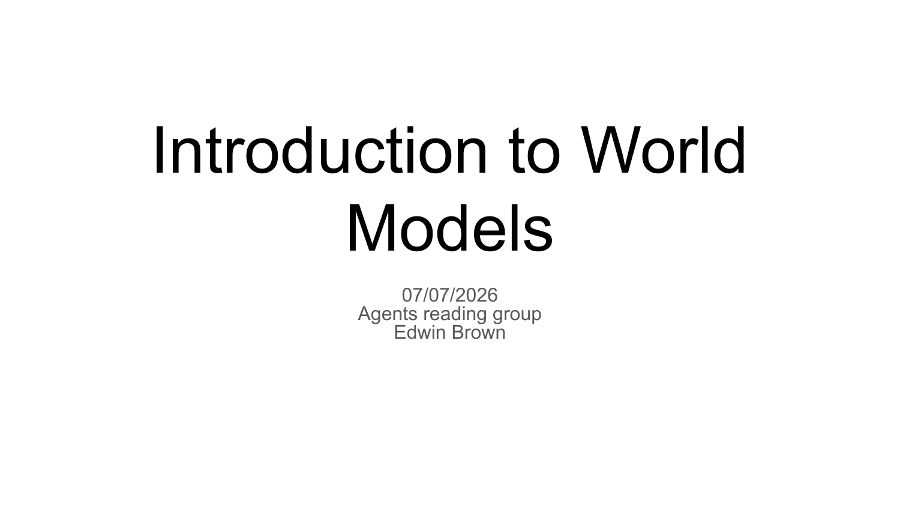

---

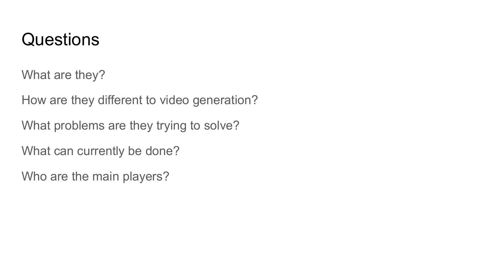

---

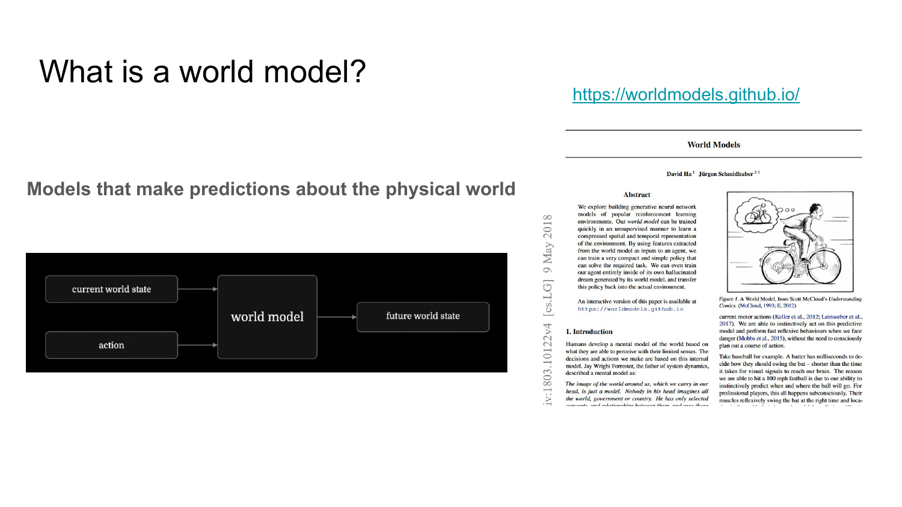

---

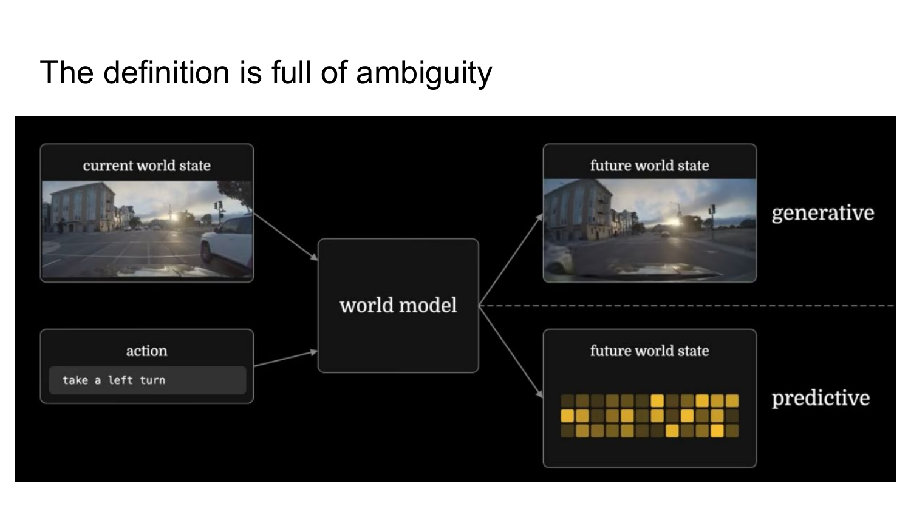

---

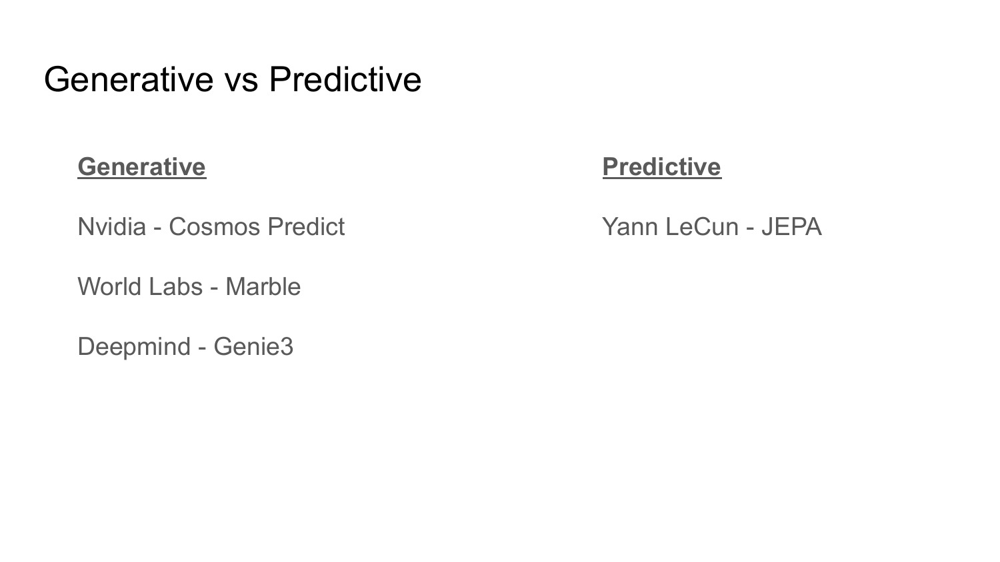

---

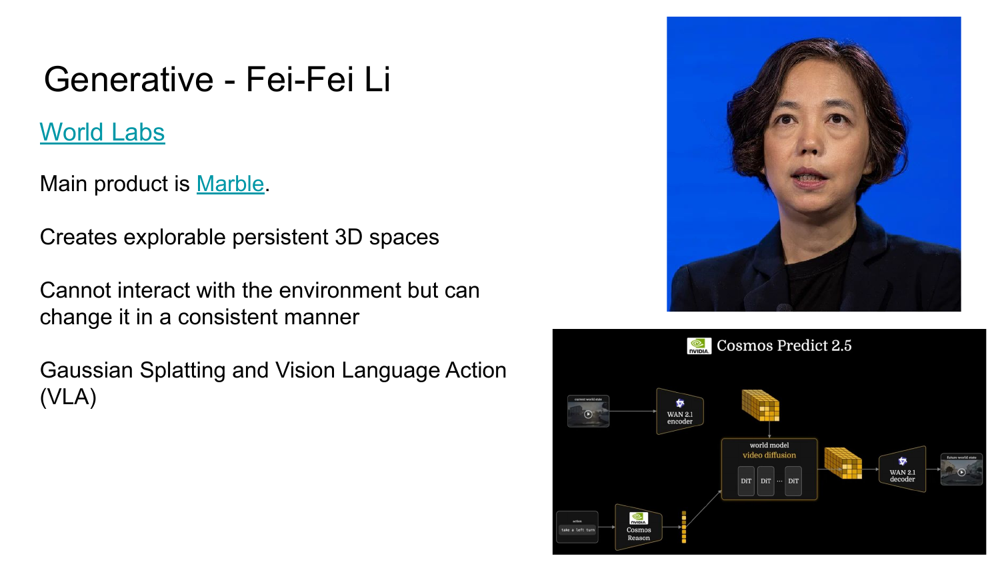

---

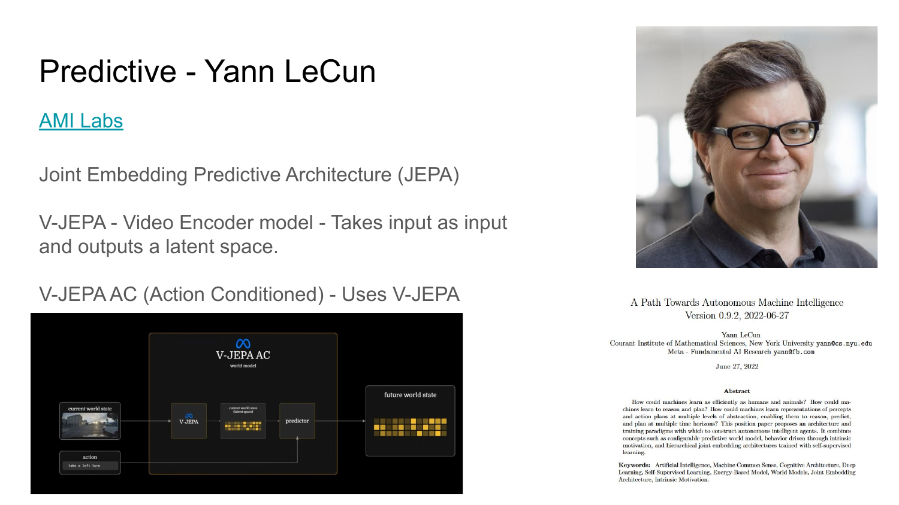

---

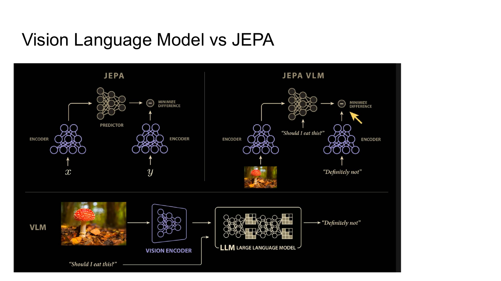

---

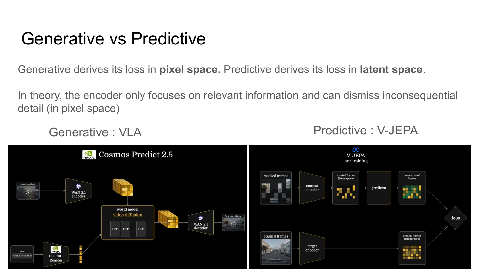

---

---

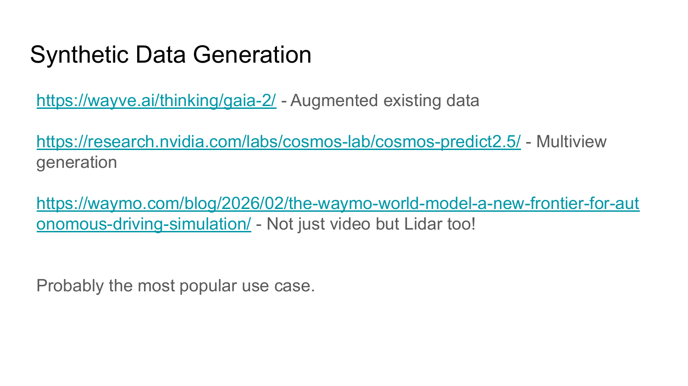

---

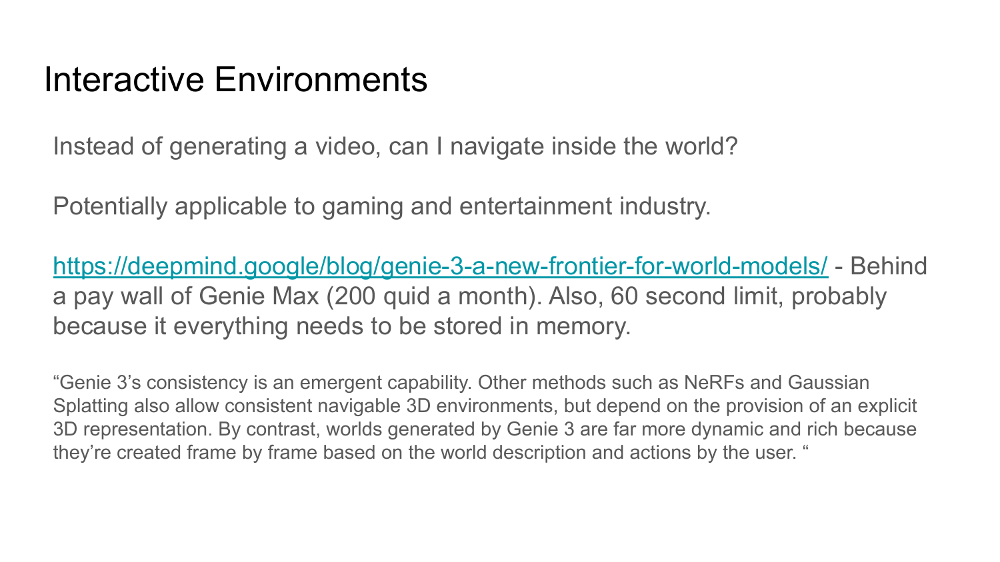

---

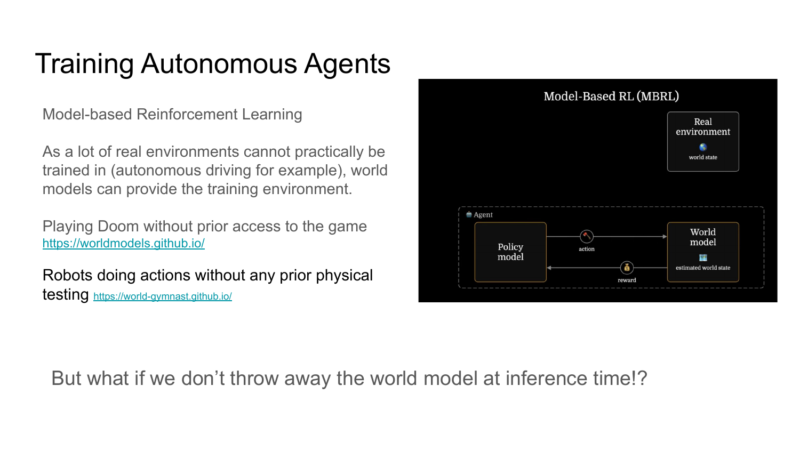

---

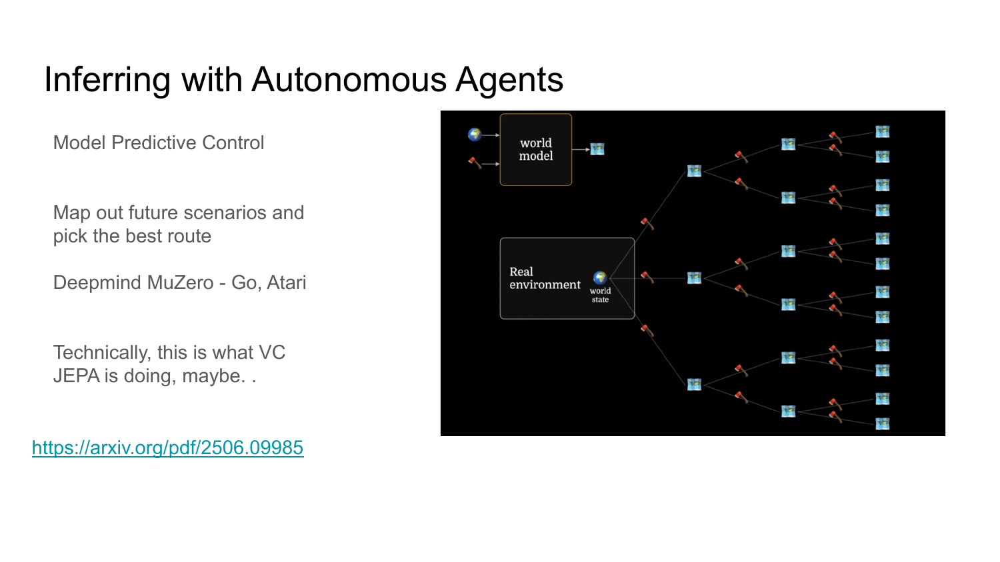

---

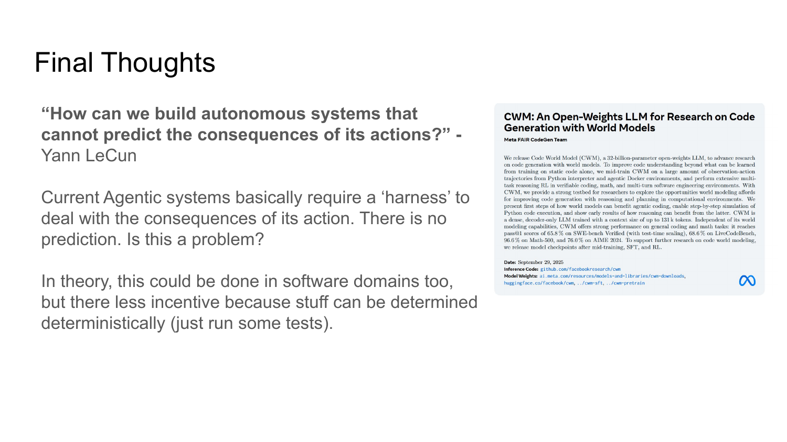

---

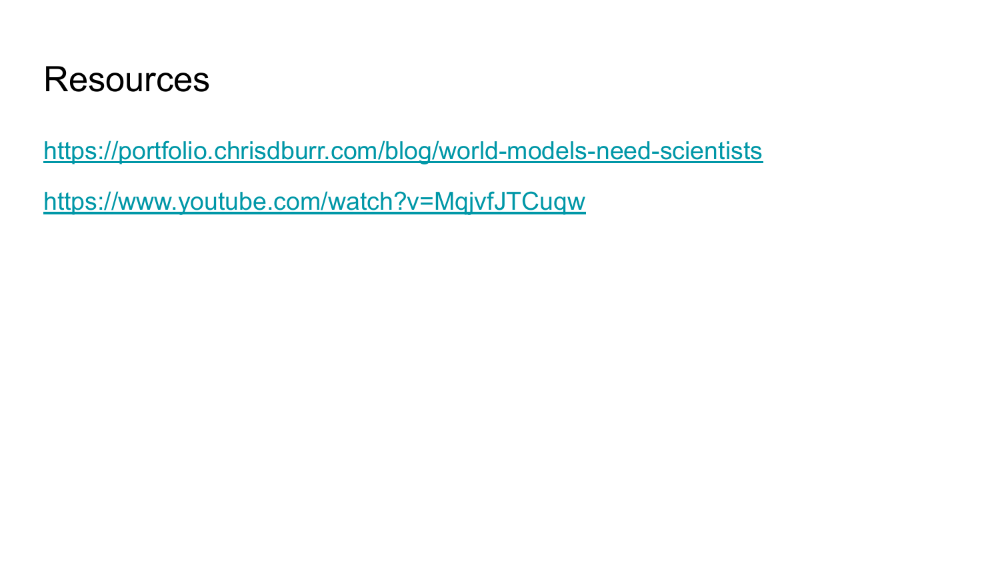
