<!-- _class: lead -->

# Introduction to World Models

_Agents reading group_

**Session:** 07/07/2026
**Lead:** Edwin Brown

---

## Questions

What are they?

How are they different to video generation?

What problems are they trying to solve?

What can currently be done?

Who are the main players?

---

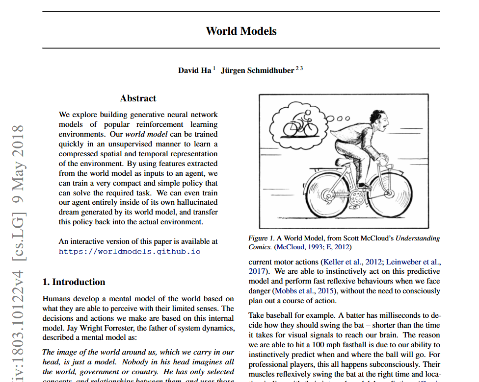

## What is a world model?

<https://worldmodels.github.io/>

**Models that make predictions about the physical world**

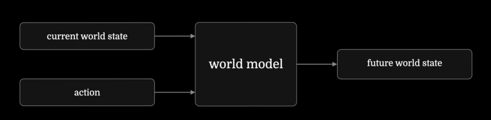

---

## The definition is full of ambiguity

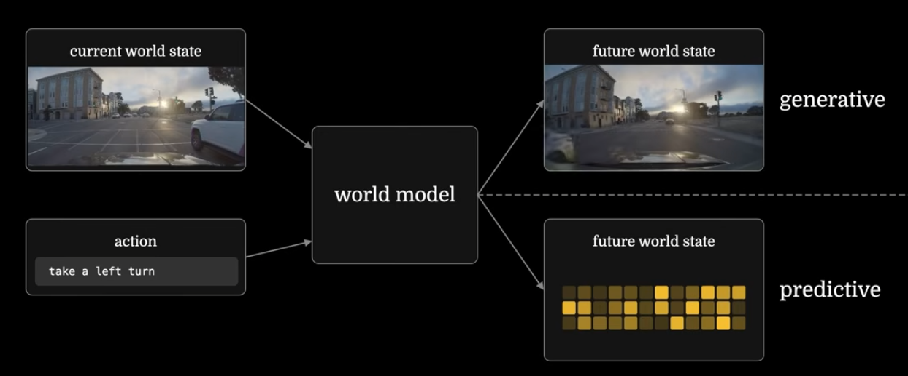

---

## Generative vs Predictive

**Generative**

Nvidia - Cosmos Predict

World Labs - Marble

Deepmind - Genie3

**Predictive**

Yann LeCun - JEPA

---

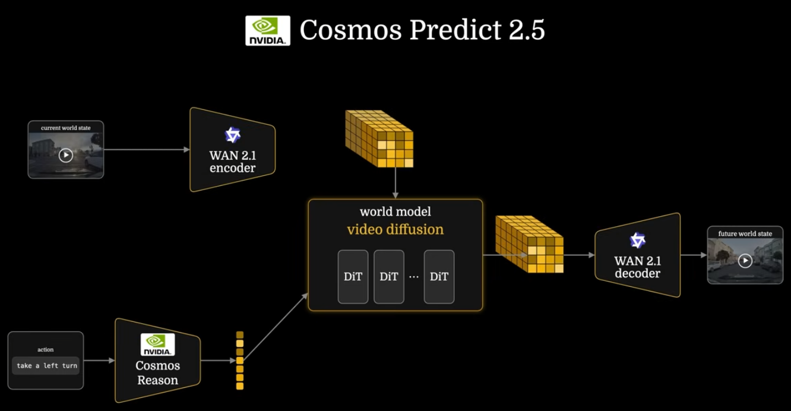

## Generative - Fei-Fei Li

[World Labs](https://www.worldlabs.ai/)

Main product is [Marble](https://www.worldlabs.ai/blog/marble-world-model).

Creates explorable persistent 3D spaces

Cannot interact with the environment but can change it in a consistent manner

Gaussian Splatting and Vision Language Action (VLA)

---

<!-- _class: small -->

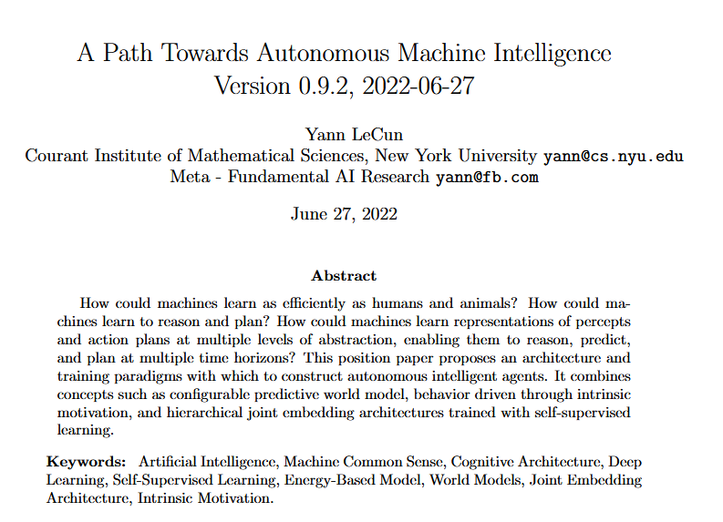

## Predictive - Yann LeCun

[AMI Labs](https://amilabs.xyz/)

Joint Embedding Predictive Architecture (JEPA)

V-JEPA - Video Encoder model - Takes input as input and outputs a latent space.

V-JEPA AC (Action Conditioned) - Uses V-JEPA

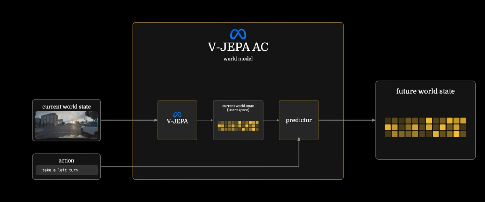

---

## Vision Language Model vs JEPA

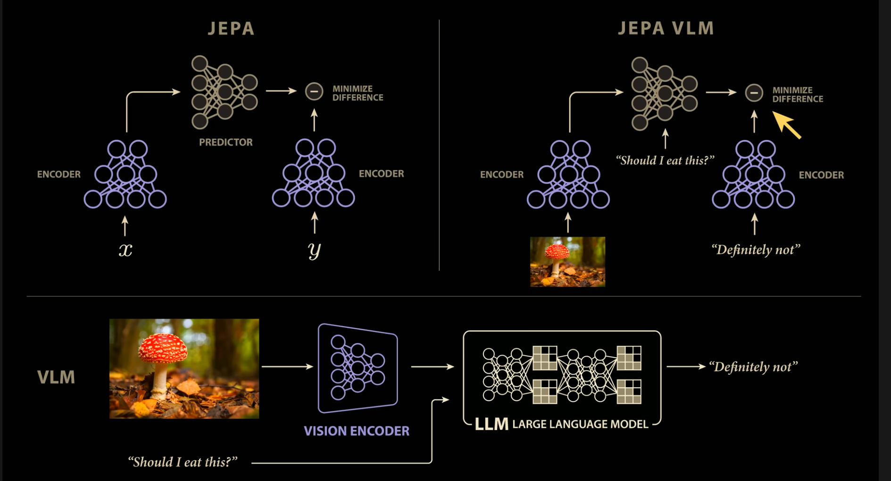

---

<!-- _class: small -->

## Generative vs Predictive

Generative derives its loss in **pixel space.** Predictive derives its loss in **latent space**.

In theory, the encoder only focuses on relevant information and can dismiss inconsequential detail (in pixel space)

Generative : VLA

Predictive : V-JEPA

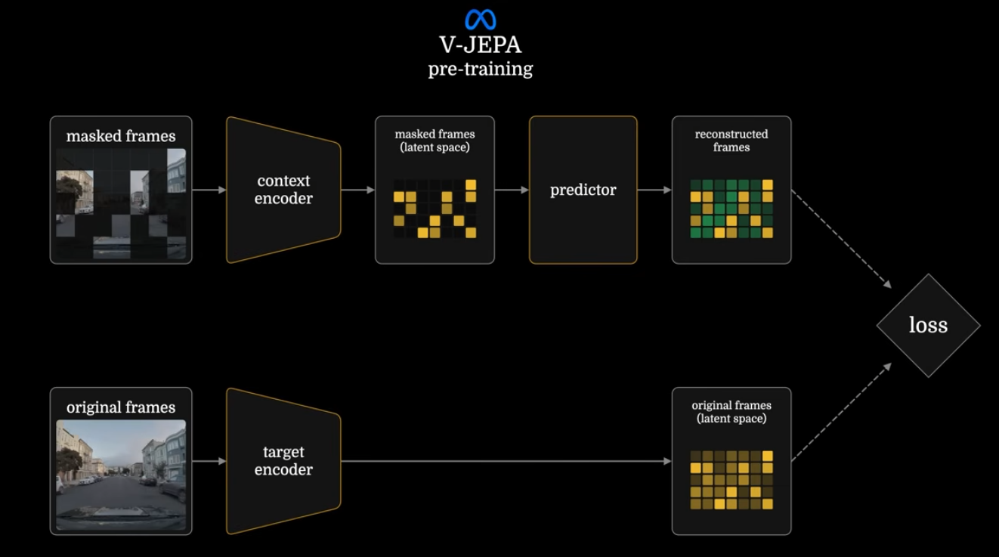

---

<!-- _class: lead -->

# Applications

---

## Synthetic Data Generation

<https://wayve.ai/thinking/gaia-2/> - Augmented existing data

<https://research.nvidia.com/labs/cosmos-lab/cosmos-predict2.5/> - Multiview generation

<https://waymo.com/blog/2026/02/the-waymo-world-model-a-new-frontier-for-autonomous-driving-simulation/> - Not just video but Lidar too!

Probably the most popular use case.

---

<!-- _class: small -->

## Interactive Environments

Instead of generating a video, can I navigate inside the world?

Potentially applicable to gaming and entertainment industry.

<https://deepmind.google/blog/genie-3-a-new-frontier-for-world-models/> - Behind a pay wall of Genie Max (200 quid a month). Also, 60 second limit, probably because it everything needs to be stored in memory.

“Genie 3’s consistency is an emergent capability. Other methods such as NeRFs and Gaussian Splatting also allow consistent navigable 3D environments, but depend on the provision of an explicit 3D representation. By contrast, worlds generated by Genie 3 are far more dynamic and rich because they’re created frame by frame based on the world description and actions by the user. “

---

<!-- _class: small -->

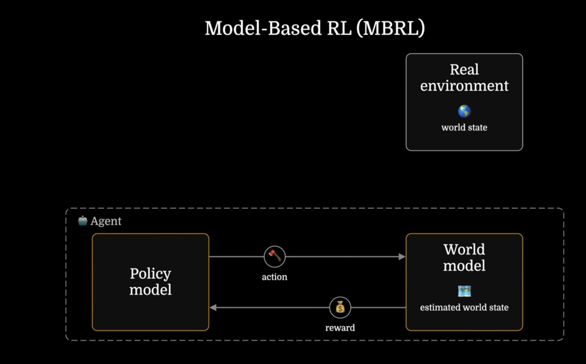

## Training Autonomous Agents

Model-based Reinforcement Learning

As a lot of real environments cannot practically be trained in (autonomous driving for example), world models can provide the training environment.

Playing Doom without prior access to the game
<https://worldmodels.github.io/>

Robots doing actions without any prior physical testing <https://world-gymnast.github.io/>

But what if we don’t throw away the world model at inference time!?

---

<!-- _class: small -->

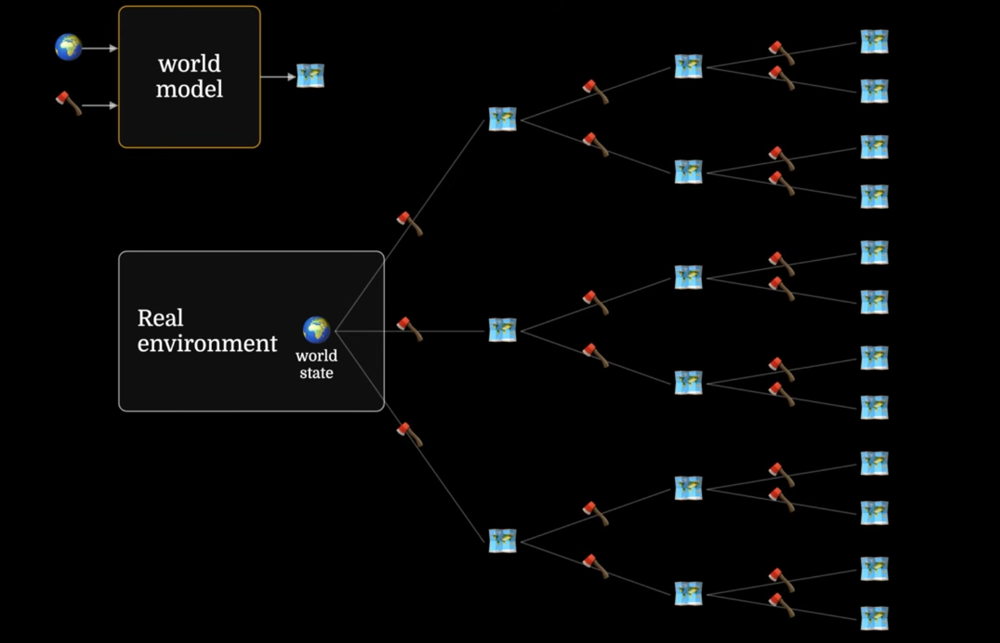

## Inferring with Autonomous Agents

Model Predictive Control

Map out future scenarios and pick the best route

Deepmind MuZero - Go, Atari

Technically, this is what VC JEPA is doing, maybe. .

<https://arxiv.org/pdf/2506.09985>

---

<!-- _class: small -->

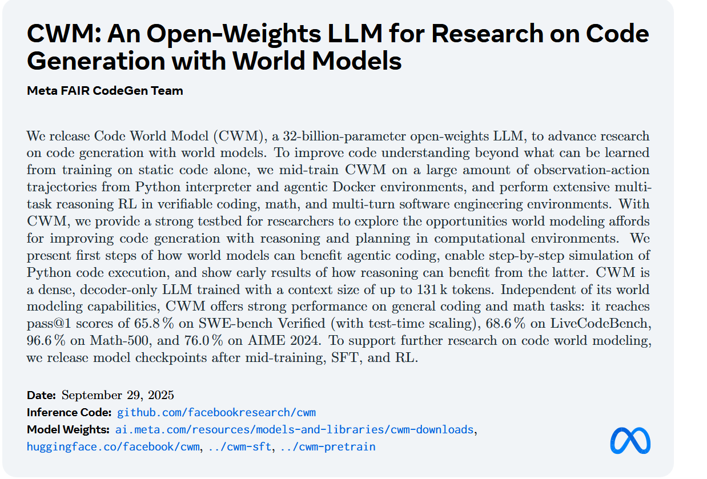

## Final Thoughts

**“How can we build autonomous systems that cannot predict the consequences of its actions?” -** Yann LeCun

Current Agentic systems basically require a ‘harness’ to deal with the consequences of its action. There is no prediction. Is this a problem?

In theory, this could be done in software domains too, but there less incentive because stuff can be determined deterministically (just run some tests).

---

## Resources

<https://portfolio.chrisdburr.com/blog/world-models-need-scientists>

<https://www.youtube.com/watch?v=MqjvfJTCuqw>
