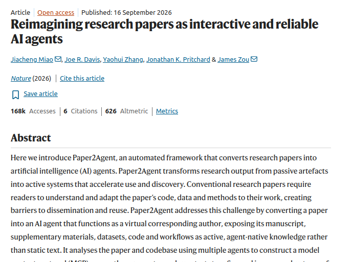
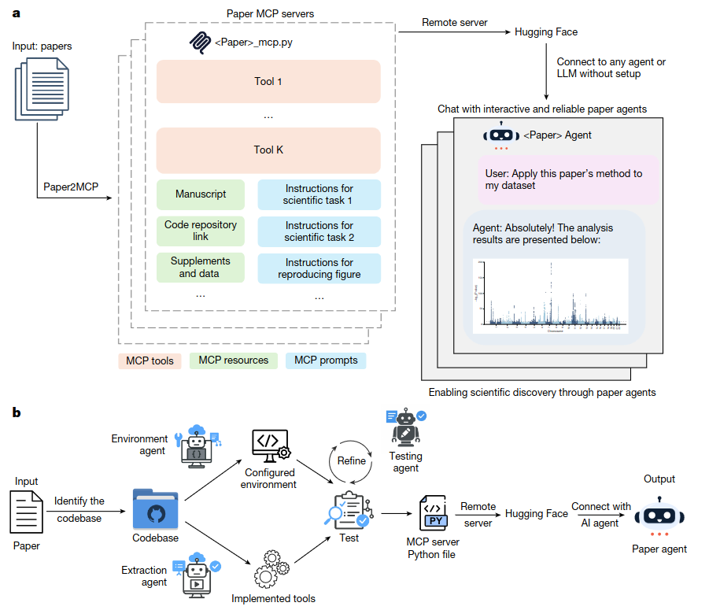
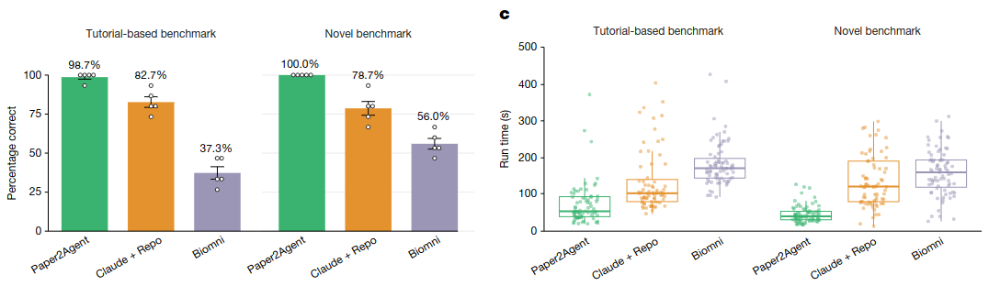
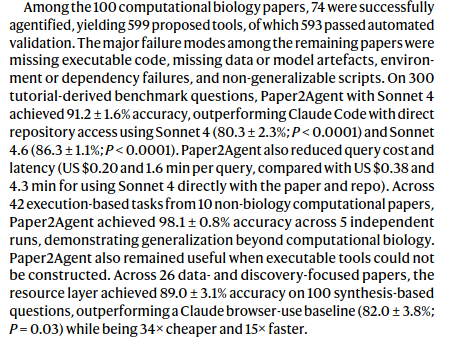
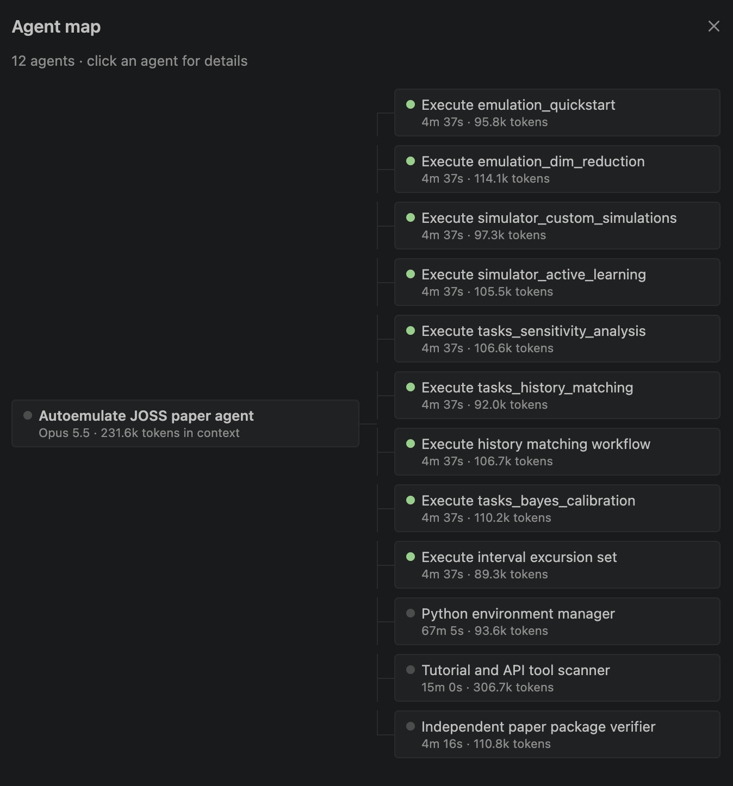

<!-- _class: lead -->

# Paper2Agent

[https://www.nature.com/articles/s41586-026-11044-y](https://www.nature.com/articles/s41586-026-11044-y#code-availability)

**Session:** 13/10/2026
**Lead:** Edwin Brown

---

<!-- _class: small -->

**Authors and Affiliations**

1. _Department of Genetics_, Stanford University, Stanford, CA, USA
   **Jiacheng Miao, Joe R. Davis & Jonathan K. Pritchard**
2. _Department of Biomedical Data Science,_ Stanford University, Stanford, CA, USA
   **Jiacheng Miao & James Zou**
3. _Department of Electrical Engineering_, Stanford University, Stanford, CA, USA
   **Yaohui Zhang & James Zou**
4. _Department of Biology_, Stanford University, Stanford, CA, USA
   **Jonathan K. Pritchard**
5. _Department of Computer Science_, Stanford University, Stanford, CA, USA
   **James Zou**

---

## The Motivation

“papers are fundamentally passive objects: a reader must discover the paper (not an easy task given the flood of publications), parse its contributions and manually determine how to apply them to their own work. In particular, when a paper describes a new computational method, substantial technical barriers often remain before the method can be used on new data.”

“research outputs are passively siloed behind technical barriers. Paper2Agent reimagines research dissemination by turning static papers into active AI agents. Each agent serves as an interactive expert on the corresponding paper, capable of demonstrating, applying and adapting its methods to new projects.”

---

<!-- _class: small -->

## Model Context Protocols (MCP) and Skills

| Dimension | Skills | MCP |
|---|---|---|
| Primary purpose | Teach an agent **how to perform a task** | Give an agent **capabilities/tools it can use** |
| Core question | _“How should I do this?”_ | _“What can I do?”_ |
| Contains | Instructions, methodology, workflows, rules, domain knowledge | Tools, APIs, data sources, resources |
| Example | “How to assess whether a paper is reproducible” | “Read a GitHub repository” |
| Agent interaction | Agent selects/loads a relevant skill | Agent selects and calls a tool |
| Typical content | SKILL.md, prompts, procedures, reference material | Tool definitions, schemas, API interfaces |

---

Paper2MCP (which is a skill) turns your code into an MCP server so an agent can use it.

Then there idea is you make this MCP public, and anyone can access it and use your paper interactively.

Can ask CC to do stuff like: Implement the method in this paper but with a dataset I have here

---

<!-- _class: small -->

## How did they validate it?

Dived into 2 example in detail: AlphaGeonome and Scanpy

For AlphaGenome: “we benchmarked the AlphaGenome agent against human- executed ground truth, Claude Code with direct repository access (Claude + Repo) and Biomni ([https://biomni.stanford.edu/](https://biomni.stanford.edu/)) (Fig. 2b).”

 The Paper2Agent-generated agent did not have access to the manu-
script or raw repository during evaluation,

---

## [https://github.com/jmiao24/Paper2Agent/tree/main](https://github.com/jmiao24/Paper2Agent/tree/main)

Lets look at their repo.

---

## I tried it out on a toy example . .

“Use the paper2agent skills to convert [https://github.com/alan-turing-institute/autoemulate](https://github.com/alan-turing-institute/autoemulate) into MCP tools in this project directory.
For now, only focus on the functionality needed to run the tutorial at [https://github.com/alan-turing-institute/autoemulate/blob/main/docs/tutorials/emulation/01\_quickstart.ipynb](https://github.com/alan-turing-institute/autoemulate/blob/main/docs/tutorials/emulation/01_quickstart.ipynb)”

- Builds a 5 tool MCP server for my quickstart
- Then becomes very quick to fiddle with the tutorial, changes parameters, extending it, etc.

---

## Large Scale Evaluation

---

<!-- _class: small -->

## I tried it out a bigger example. .

“Agentify this paper: [https://www.theoj.org/joss-papers/joss.10087/10.21105.joss.10087.pdf](https://www.theoj.org/joss-papers/joss.10087/10.21105.joss.10087.pdf) . The codebase is in this dir: . . .

Entire Auto Emulate codebase - ~200K LOC

Takes forever to build the MCP server

What I learned is its better suited to research papers with code provided rather than developed codebases.

1st attempt hit my token limit

2nd attempt, hit 3 hours and gave up. .

---

## Discussion

Do we want this?

Is this an efficient way of dissemination?

I understand why this is quicker, but why can’t Claude Code approach get to the same level of accuracy?

Authors suggest using this approach as a ‘check’ for whether a paper is ‘ready for reproducibility’.

---

## Paper2MCP

**MCP tools** are executable functions that encapsulate a paper’s methodological contributions.

**MCP resources** serve as a repository of static assets, including the manuscript text, the associated codebase and supplementary materials such as datasets, tables and figures.

**MCP prompts** contain concise instructions that guide AI agents through complex, multi-step scientific workflows derived from a paper’s text or codebase.

