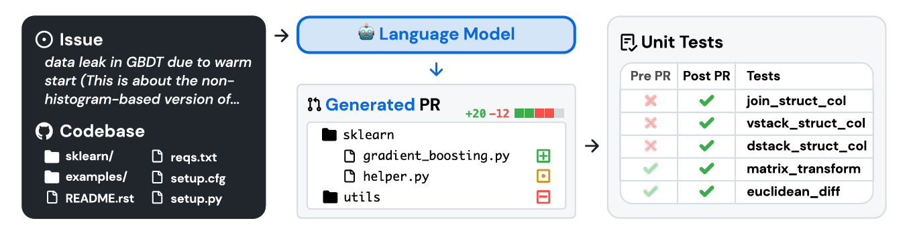

<!-- _class: lead -->

# SWE-bench Verified and SWE-bench Pro

_What do coding-agent benchmarks actually measure?_

**Session:** 8th December 2026
**Lead:** TBC

---

## Overview

- How SWE-bench works
- SWE-bench Verified: how it became the standard
- Why OpenAI stopped reporting it (Feb 2026)
- SWE-bench Pro: what changed, what didn't
- Activity: inspect real benchmark tasks
- Discussion: what should we trust?

---

<!-- _class: small -->

## What is SWE-bench?

- Input: a real GitHub issue and a snapshot of the repository
- The agent produces a **patch**
- Hidden tests decide the outcome: **FAIL → PASS** (issue fixed) and **PASS → PASS** (nothing broke)
- Score = % of tasks **resolved**

_Jimenez et al., "SWE-bench: Can Language Models Resolve Real-World GitHub Issues?", 2023_

---

## SWE-bench Verified

- **500** tasks from 12 Python repositories
- Subset of the original SWE-bench, **human-validated** by engineers
- Released by OpenAI in 2024 to remove unfair or broken tasks
- Became the headline number in nearly every model launch
- Scores rose from low double digits to near ceiling in about two years

---

## Why OpenAI dropped it

_OpenAI, 23 February 2026: "Why we no longer evaluate SWE-bench Verified"_

1. **Flawed tests**
   - Audit of a hard subset (27.6% of tasks, often failed by models)
   - At least 59.4% of those had tests that reject functionally correct solutions
2. **Contamination**
   - Open-source repos and issues are widely used in training
   - Models that have seen a task do better, especially when tests are underspecified

[scikit-learn example](https://openai.com/index/introducing-swe-bench-verified/)
Conclusion: gains no longer reflect real coding ability.

---

<!-- _class: small -->

## SWE-bench Pro

_Scale AI, 2025_

- **1,865** tasks from **41** repositories
- Includes **copyleft** and **private commercial** codebases, which are harder to find in training data
- Long-horizon: reference patches average about **107 changed lines** (Verified: 11.6), often across several files
- Tasks may take a professional hours to days
- Frontier scores far lower than Verified at launch

_The v1 and v2 of the paper report different headline scores. Check which version you are citing._

---

<!-- _class: small -->

## Side by side

| | Verified | Pro |
|---|---|---|
| Creator | OpenAI | Scale AI |
| Tasks | 500 | 1,865 |
| Repositories | 12 (Python) | 41 |
| Source | Public open source | Public, copyleft and private |
| Avg. patch size | ~12 lines | ~107 lines |
| Languages | Python | Python, JS, TS, Java, C++, Go, Rust |

---

## Open questions

- Is every static public benchmark doomed to saturate? (claude-4-5-Sonnet	43.7%, claude-5-5-Sonnet  81.3%)
- Does contamination resistance last once tasks are released?
- Reports suggest Pro has grading issues of its own. Treat as unverified until checked against primary sources.
- Leaderboard scores depend on the **scaffold**, tool set, attempts and compute, not just the model

---

<!-- _class: small -->

## Practical activity (~25 min)

**Goal:** see what a SWE-bench task really looks like.

**Instructions:**

- Read SWE-bench Verified and Pro tasks on Hugging Face
- Inspect the issue text, reference patch, and hidden tests

[SWE-bench Verified](https://huggingface.co/datasets/SWE-bench/SWE-bench_Verified)
[SWE-bench Pro](https://huggingface.co/datasets/ScaleAI/SWE-bench_Pro)

---

## Discussion

1. Saturation and the lifespan of benchmarks
2. Contamination vs. test quality: which matters more?
3. Does Pro really fix it?
4. Scaffold vs. model: comparing vendor scores fairly
5. Who should build and maintain benchmarks?
6. Resolved issues vs. useful software engineering
7. Research software: would these scores predict usefulness for us?
8. What should we report when using a coding agent?

---

<!-- _class: small -->

## Links

- [SWE-bench (arXiv)](https://arxiv.org/abs/2310.06770)
- [SWE-Bench Pro (arXiv)](https://arxiv.org/abs/2509.16941)
- [SWE-bench Pro (Scale Labs)](https://labs.scale.com/papers/swe-bench-pro)
- [Why we no longer evaluate SWE-bench Verified (OpenAI)](https://openai.com/index/why-we-no-longer-evaluate-swe-bench-verified/)
- [OpenAI drops SWE-Bench Verified, backs Pro (AI Weekly)](https://aiweekly.co/alerts/openai-drops-swe-bench-verified-backs-pro-after-flaw-audit)
- [SWE-bench contamination debate (Codesota)](https://codesota.com/news/swe-bench-contamination-debate)
